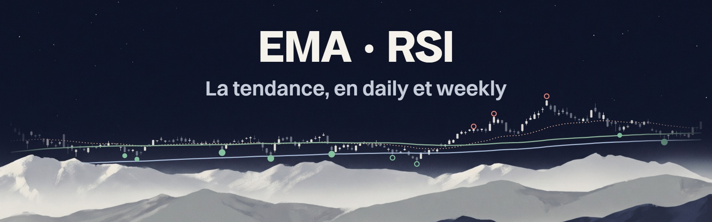

# EMA · RSI

**La tendance, en daily et weekly.** Les moyennes mobiles et le RSI dans un seul indicateur TradingView, pour repérer le moment où un titre en tendance revient sur un support avec un RSI en survente.

## En bref

- **Une seule place** sur le plan gratuit : le script vit dans le volet du RSI, et envoie sur le graphique les moyennes, les repères et le tableau.
- **Les supports** : l'EMA 32 pour le court terme, la MA 100 et l'EMA 200 pour les grands supports.
- **Le RSI, sans attendre** : la clôture qui le ferait passer en survente, et un point dès qu'il s'y retourne.
- **Le RSI, confirmé** : les failure swings de Wilder, les divergences et le régime du RSI.
- **Quatre thèmes** : Actuel, Cobalt, Graphite et Nuit verte.

## Installation

1. Ouvre l'**éditeur Pine Script** de [TradingView](https://tradingview.com/) : nouveau script de type indicateur.
2. Colle le contenu de [`Main_Indicator.pine`](Main_Indicator.pine), puis **Enregistrer** et **Ajouter au graphique**.
3. Retire ton ancien indicateur de moyennes et le RSI natif : ils font doublon.

Après une mise à jour du code, retire l'indicateur du graphique puis remets-le : sinon, TradingView garde les réglages de l'ancienne version.

## Lire le graphique

| Repère | Où | Ce qu'il dit |
|---|---|---|
| EMA 32, MA 100, EMA 200 | Sur le prix, avec leur nom en bout de ligne | La tendance court terme et les deux grands supports |
| Point vert | Sous la bougie et dans le RSI | Le RSI repart de la survente avec le cours au-dessus de l'EMA 200 : un repli dans une tendance haussière |
| **Gros point vert** | Sous la bougie et dans le RSI | Pareil, pendant que le prix touche la MA 100 ou l'EMA 200 : **le signal le plus solide** |
| Anneau vert | Sous la bougie et dans le RSI | Une survente sous l'EMA 200, contre la tendance : le rebond est possible, mais plus risqué |
| Point ou anneau rouge | Au-dessus de la bougie et dans le RSI | Le RSI repart du surachat : plein sous l'EMA 200, anneau au-dessus |
| « RSI 30 à 76,40 » | À droite du prix | Une clôture à 76,40 ou moins à la prochaine barre ferait passer le RSI en survente |
| Triangle vert ou rouge | Dans le RSI | Une survente ou un surachat **confirmé** : le failure swing de Wilder |
| Div+, Div− | Dans le RSI | Une divergence : le prix et le RSI ne vont plus dans le même sens |

## Le RSI, sans attendre et confirmé

Le retard du RSI vient surtout de l'attente : qu'il touche 30, puis qu'il ressorte de la zone. L'indicateur la raccourcit de trois façons :

- **Les prix déclencheurs**, sans retard : la clôture qu'il faudrait à la prochaine barre pour toucher la survente ou le surachat. C'est la méthode du RSI inversé de Giorgos Siligardos : le niveau est connu d'avance, tu peux y placer un ordre.
- **Le point de retournement**, une barre de retard : il marque le creux du RSI en survente dès que le RSI repart, en général plusieurs barres avant la sortie de zone. Un seul point par passage, sauf si le RSI va plus loin.
- **Les seuils adaptatifs**, en option : la survente et le surachat deviennent les niveaux que le RSI de ce titre n'a franchis que 10 % du temps sur ses 250 dernières barres. En tendance haussière, la survente remonte vers 40 : tu n'attends plus un 30 qui ne vient jamais.

Et il le confirme :

- **Le failure swing de Wilder**, en triangle : le RSI passe en survente, remonte d'au moins 5 points au-dessus d'elle, se replie d'au moins 2 sans y retourner, puis dépasse le sommet de son rebond. La figure est abandonnée au-delà de 30 barres.
- **Les divergences**, confirmées 3 barres après le pivot. Par défaut, seulement celles qui partent d'une zone extrême.
- **Le régime du RSI**, dans le tableau : haussier quand il tient au-dessus de 40 sur les 50 dernières barres, baissier quand il plafonne sous 60. C'est la lecture d'Andrew Cardwell et de Constance Brown.

## Le tableau

En haut à droite par défaut, pour laisser le bas à Sessions · Liquidité.

| Ligne | Ce qu'elle dit |
|---|---|
| Tendance CT | L'EMA 13 au-dessus ou en dessous de l'EMA 32, et depuis combien de barres |
| MA 100, EMA 200 | L'écart du cours avec chaque support : orange au contact, rouge en dessous |
| RSI 14 | Sa valeur, et depuis combien de barres il est en zone extrême : « 28,4 · survente 4 j » |
| Régime RSI | Haussier, plancher 40 ; baissier, plafond 60 ; sinon neutre |

## Les alertes

Clic droit sur le graphique, **Ajouter une alerte**, condition **EMA · RSI**, fréquence **Une fois par clôture de barre**. Les trois plus utiles :

- **RSI se retourne en survente sur un support** : le gros point vert, l'alerte la plus sélective ;
- **Failure swing haussier** : la survente confirmée ;
- **RSI entre en survente** : pour être prévenu dès que le titre devient intéressant.

Les dix autres : RSI entre en surachat, RSI se retourne en survente, RSI se retourne en surachat, Failure swing baissier, Divergence haussière RSI, Divergence baissière RSI, Contact d'un support, Croisement haussier CT, Croisement baissier CT, Clôture sous Support 2.

## Les réglages

Les réglages par défaut conviennent au daily et au weekly. À changer seulement si besoin :

| Réglage | Groupe | Quand le changer |
|---|---|---|
| Thème | Apparence | Pour accorder l'indicateur à ta chart |
| Type et longueur des moyennes | 1 · Moyennes mobiles | EMA, MA, SMMA, WMA, VWMA ou HMA ; la case de chaque ligne la masque |
| EMA 13 et nuage | 1 · Moyennes mobiles, 2 · Nuage et supports | À réafficher en weekly, où ils découpent bien les grandes phases |
| Tolérance de contact | 2 · Nuage et supports | À monter sur un titre très volatil (0,5 ATR par défaut) |
| Seuils adaptatifs | 3 · RSI | Si le RSI du titre ne descend jamais à 30 |
| Masquer les points contre la tendance | 4 · Signaux du RSI | Pour ne garder que les signaux dans le sens de la tendance |
| Divergences en formation | 5 · Divergences du RSI | Pour les voir plus tôt, avec plus de fausses alertes |
| Position du tableau | 6 · Tableau | L'un des quatre coins |

<b>Les moyennes, en détail</b>

| Rôle | Par défaut | Affichée |
|---|---|---|
| Rapide | EMA 13 | Non : calculée pour le tableau |
| Intermédiaire | EMA 25 | Non |
| Lente | EMA 32 | Oui |
| Support 1 | MA 100 | Oui |
| Support 2 | EMA 200 | Oui |
| Support 3 | MA 300 | Non |
| Autre UT | EMA 200 en 4H | Non |

MA désigne la moyenne mobile simple. L'EMA 32 sert de support quand une tendance est trop forte pour revenir jusqu'à la MA 100 : une clôture nette dessous signale que le court terme s'essouffle. En weekly, une EMA 13 et une EMA 32 représentent environ 3 et 8 mois.

Les premières versions de l'indicateur calculaient leur « EMA 200 » comme une SMMA 99, qui équivaut à une EMA 197 : la ligne est presque identique. Pour retrouver ce calcul, choisis SMMA et 99 sur le Support 2.

<b>Les quatre thèmes, et la chart qui va avec</b>

Le calcul est le même dans les quatre ; seules les couleurs changent. L'indicateur gère les siennes. Le fond, les bougies et tes zones se règlent une fois dans TradingView :

| Élément | Où le régler | Actuel | Cobalt | Graphite | Nuit verte |
|---|---|---|---|---|---|
| Thème de l'interface | Menu principal | inchangé | clair | clair | sombre |
| Fond | Paramètres du graphique, Canevas | inchangé | #FFFFFF | #FFFFFF | #0F1412 |
| Grille | Paramètres du graphique, Canevas | inchangée | masquée | masquée | masquée |
| Texte des échelles | Paramètres du graphique, Canevas | inchangé | #6A6F78 | #6A6F78 | #8A968F |
| Bougies haussières | Paramètres du graphique, Symbole | inchangées | #2453D6 | corps #FFFFFF, bordure et mèche #1C1F26 | #9FD8C0 |
| Bougies baissières | Paramètres du graphique, Symbole | inchangées | #1C1F26 | #1C1F26 | #4F5C57 |
| Zones (rectangles) | Style du rectangle | inchangées | #2453D6, opacité 6 %, sans bordure | #0D7A66, opacité 7 %, sans bordure | #5FB3A1, opacité 10 %, sans bordure |

Enregistre chaque réglage du graphique avec le menu **Modèle**, en bas à gauche de ses paramètres, et le style du rectangle avec le bouton **Modèle** de sa barre. Pour changer d'ambiance : le modèle du graphique, puis le même thème dans l'indicateur.

## Bon à savoir

- **Les repères ne bougent plus** une fois posés : points, triangles et divergences sont confirmés à la clôture. Le prix déclencheur, lui, vaut pour la prochaine clôture et se recalcule à chaque bougie.
- **Une moyenne attend son historique** : l'EMA 200 n'apparaît qu'après 200 barres, et le tableau affiche « n/d » d'ici là.
- **500 étiquettes au plus** par indicateur : sur un très long historique, les repères les plus anciens disparaissent.
- **Sur un fond clair**, les textes trop pâles s'assombrissent d'eux-mêmes jusqu'à un contraste lisible de 4,5:1.
- **La moyenne « Autre UT »** bouge tant que sa bougie n'est pas close : elle sert à lire le graphique, pas aux signaux.
- C'est un outil de lecture du graphique, pas un conseil en investissement.

---

Un indicateur de [Cyberia](https://cyberiaclub.fr). Pour l'intraday, son voisin : [Sessions · Liquidité](https://github.com/Tomas-Cyberia/Sessions_Liquidite).
